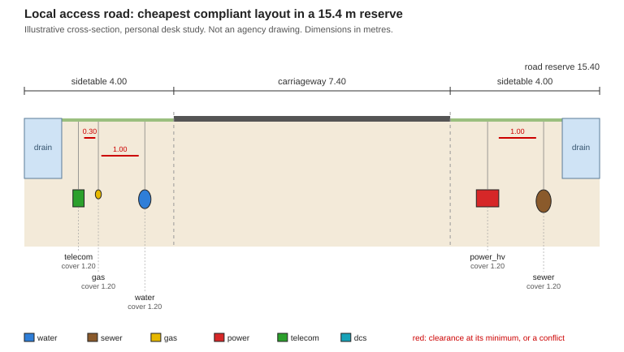
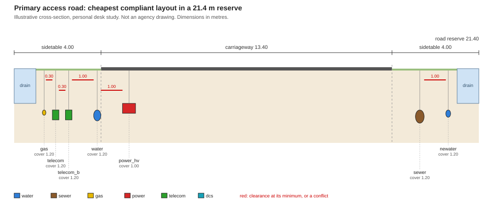
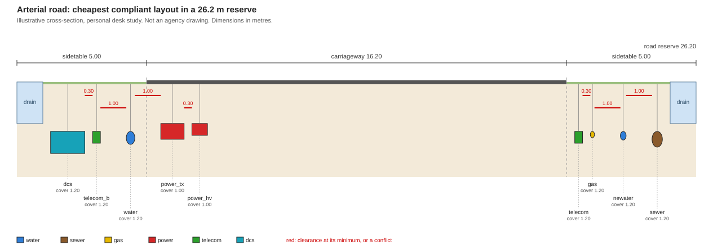
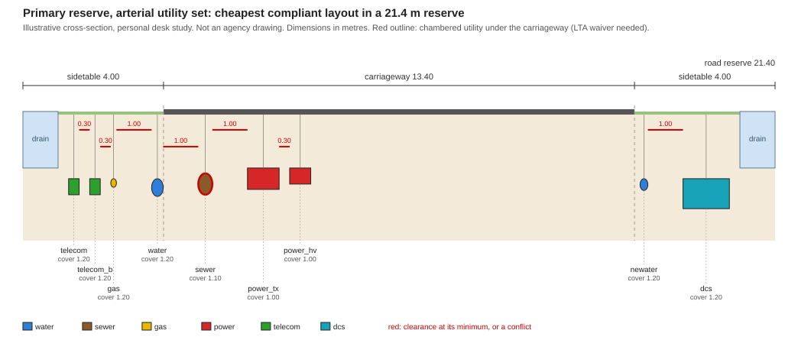
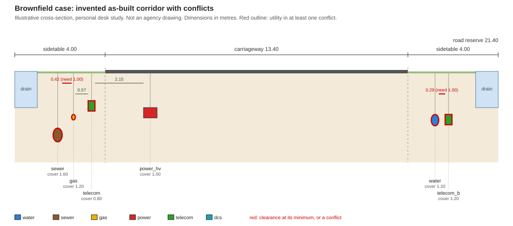
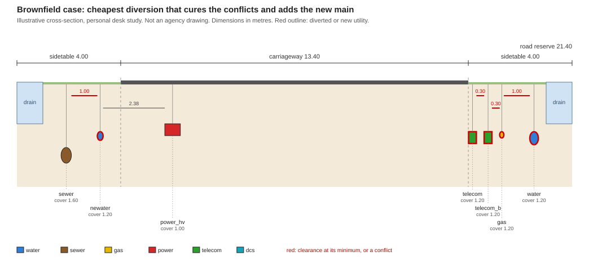

# sg-utility-tunnel-cba

**Personal desk study on public information; not a URA/agency study; costs are scenario assumptions with sources.**

A screening-level lifecycle cost-benefit and staging study of a **common services tunnel (CST)** versus
**direct-buried utilities** for a hypothetical new Singapore district. The district, its programme and
almost every unit cost are scenario assumptions. The few public figures used are cited in
[docs/sources.md](docs/sources.md), together with what could not be verified.

A second part checks whether the direct-buried option fits at all: a **utility corridor cross-section** with
each agency's cover and clearance rules (cited by document and clause, or labelled as an assumption), a
conflict checker, and an optimiser that places the utilities in a road reserve and shows which rules bind and
what a diversion costs. See [Utility corridor](#utility-corridor-agency-clearances-conflict-check-and-placement).

<!-- Generated by scripts/build_readme.py from results/*.json. Edit docs/README.template.md instead. -->

## Headline results

All money is SGD million **per km of corridor**, real prices, as the CST's NPV relative to direct burial
(positive = the CST pays off). Base discounting is the HM Treasury Green Book 2026
declining schedule (3.00% / 2.50% / 2.25% real).

| Case | 50 years | 100 years | File |
|---|---|---|---|
| Base inputs, economic view (disruption costs counted) | -26.5 | -31.8 | `results/cost.json` `base` |
| Base inputs, financial view (no disruption costs) | -38.9 | -47.6 | `results/cost.json` `financial_only` |
| High-load district (CBD-like) | 28.3 | 38.3 | `results/cost.json` `scenarios` |
| Moderate-load district (estate-like) | -39.8 | -48.7 | `results/cost.json` `scenarios` |
| Monte Carlo P(CST pays), economic view | 28.7% | 31.3% | `results/cost.json` `monte_carlo` |
| Monte Carlo P(CST pays), financial view | 0.3% | 0.3% | `results/cost.json` `monte_carlo` |

At base inputs the CST costs 75.6 per km against 26.5 for direct
burial. Over 100 years it avoids 23.9 (PV) of road openings and saves
8.5 on renewals, but adds 15.1 of tunnel O&M.

### When the CST does NOT pay off

- **At the base inputs it does not pay off**, at either horizon. The capital premium is not recovered unless
  road openings are frequent and disruptive.
- **On agency cash costs alone it almost never pays off**: with disruption costs excluded, breakeven needs
  18.9 openings per km per year (100 years), and the Monte Carlo
  probability is 0.3%. The case for a CST is an economic (disruption-avoided) case.
- **Moderate-load, estate-like districts**: NPV -48.7 per km. This matches the public
  position that CSTs suit high infrastructure loads (source S4).
- **High-load, CBD-like districts**: NPV 38.3 per km, so the CST pays off.

### Breakeven conditions (base inputs, one input varied)

| Input | Breakeven, 50 yr | Breakeven, 100 yr | CST pays when |
|---|---|---|---|
| Road openings per km per year | 7.2 | 7.0 | above |
| Social cost per opening (S$M) | 0.63 | 0.60 | above |
| Direct-buried capex / CST capex | 0.64 | 0.68 | above |
| CST size factor vs Marina Bay | 0.34 | 0.35 | below |
| Flat real discount rate | 0.86% | 0.52% | below |

Breakeven openings per km per year as a function of social cost per opening:

| Social cost per opening (S$M) | Breakeven openings/km/yr, 50 yr | Breakeven openings/km/yr, 100 yr |
|---|---|---|
| 0.00 | 19.6 | 18.9 |
| 0.10 | 10.6 | 10.2 |
| 0.20 | 7.2 | 7.0 |
| 0.40 | 4.4 | 4.2 |
| 0.80 | 2.4 | 2.3 |

### Which assumptions flip the decision

Within their swept ranges, only these flip the 100-year decision: `event_social_cost`, `events_per_km_yr`
(50 years: `event_social_cost`, `events_per_km_yr`). Everything else moves the NPV but leaves it negative at base load.
Tornado, 100 years (`results/cost.json` `tornado.h100`):

| Assumption | Low | High | NPV at low | NPV at high | Flips decision |
|---|---|---|---|---|---|
| `event_social_cost` | 0 | 0.8 | -47.6 | 15.8 | yes |
| `events_per_km_yr` | 1 | 8 | -47.7 | 8.1 | yes |
| `scale_factor` | 0.5 | 1.2 | -10.5 | -60.0 | no |
| `db_capex_ratio` | 0.2 | 0.6 | -46.4 | -7.4 | no |
| `escalation` | 1 | 1.7 | -18.7 | -49.2 | no |
| `cst_om_frac` | 0.003 | 0.015 | -24.2 | -54.4 | no |
| `discount_rate` | 0.015 | 0.07 | -19.0 | -44.0 | no |
| `event_direct_cost` | 0.05 | 0.3 | -37.0 | -18.3 | no |
| `replacement_cycle_yr` | 25 | 60 | -22.2 | -36.5 | no |
| `cst_event_reduction` | 0.6 | 0.9 | -36.5 | -27.0 | no |
| `db_repl_civil_frac` | 0.4 | 1.2 | -36.5 | -27.1 | no |
| `cst_repl_civil_frac` | 0.05 | 0.3 | -30.6 | -33.5 | no |
| `repl_disruption_events` | 3 | 25 | -32.4 | -30.4 | no |
| `cst_life_yr` | 75 | 120 | -31.8 | -30.8 | no |

Monte Carlo (20000 draws, independent triangular distributions, Green Book discounting), 100 years:
P10 -49.8, P50 -15.4, P90 30.4.

## Staging and schedule

A two-phase illustrative programme (`inputs/schedule.yaml`, `results/schedule.json`). Road pavement over each
CST segment follows its civil works, so new roads are not reopened (cf. the one-year no-opening rule, S4);
approvals for the CST protection zone are an explicit activity (S5).

- First-phase services ready at month 53; second phase at month 73.
- Critical path: `A`, `B`, `C`, `E`, `L`, `N`, `O`, `M2`.
- Duration risk (Monte Carlo, 5000 draws): second phase ready P50 month 79,
  P80 month 83, against 73 deterministic.

Delayed phases:

| Delay scenario | Float before (months) | Ph1 ready slip | Ph2 ready slip |
|---|---|---|---|
| Ph2 site formation 12 months late | 9 | 0 | 3 |
| Ph2 site formation 24 months late | 9 | 0 | 15 |
| Ph1 approvals 6 months late | 0 | 6 | 6 |
| Ph2 road pavement 6 months late | 8 | 0 | 0 |

A late second-phase site formation is absorbed by float only up to that float; beyond it the critical path
moves to site formation and the second-phase CST waits for land. A late first-phase approval slips both phases
month for month.

## Interdependencies

`results/interfaces.md` holds the pairwise interface-risk matrix for the 5 systems sharing the
tunnel (water, power, telecom, pneumatic waste, district cooling). 2 of 10 pairs
drive layout or compartmentation: `water-power`, `power-dcs`. Severities are the author's screening judgement.
A planner's review checklist for CST feasibility studies is in [docs/review_checklist.md](docs/review_checklist.md).

## Utility corridor: agency clearances, conflict check and placement

Before asking whether a tunnel pays, a planner has to know whether the direct-buried services fit in the road
reserve once every agency's cover and clearance requirement is respected, and which requirement costs the
space. This part encodes those requirements, checks a cross-section against them and places the utilities with a
mixed-integer programme (HiGHS). Reserve widths, utility sizes, drain size and unit rates are scenario
assumptions; the clearance rules are not.

### Rules and where they come from

17 rules are encoded in `inputs/corridor.yaml`. 14 were read from
7 public documents (LTA Code of Practice for Works on Public Streets; PUB codes of practice on
sewerage and on surface water drainage and its advisory note on water pipes; IMDA COPIF; SP PowerGrid / PowerGas
requirements for low-pressure gas pipes). 3 are labelled assumptions because no public figure was
found: the parallel clearance to a water main (the published figure is for crossings), and the default
clearances for pairs with no published rule, which is every pairing of power cables or district cooling pipes
that is not covered by another agency's rule. Document, clause and interpretation for each rule are in
[docs/corridor_rules.md](docs/corridor_rules.md); what was looked for and not found is in [docs/sources.md](docs/sources.md).

| Rule | Agency | Value (m) | Status |
|---|---|---|---|
| `LTA-DEPTH-CARRIAGEWAY` | LTA | 1 | sourced |
| `LTA-DEPTH-SIDETABLE` | LTA | 1.2 | sourced |
| `LTA-NO-CHAMBER-CARRIAGEWAY` | LTA | - | sourced |
| `LTA-NO-STACKING` | LTA | - | sourced |
| `PUB-SEWER-PARALLEL` | PUB | 1 | sourced |
| `PUB-SEWER-CROSSING` | PUB | 1 | sourced |
| `PUB-SEWER-DEPTH` | PUB | 1.5 | sourced |
| `PUB-WATER-COVER` | PUB | 1 | sourced |
| `PUB-WATER-CROSSING` | PUB | 1 | sourced |
| `PUB-WATER-PARALLEL` | PUB | 1 | assumption |
| `PUB-DRAIN-OFFSET` | PUB | 0.3 | sourced |
| `PUB-DRAIN-UNDERCROSS` | PUB | 1 | sourced |
| `SP-GAS-CLEARANCE` | SP PowerGrid / PowerGas | 0.3 | sourced |
| `SP-GAS-CROSSING` | SP PowerGrid / PowerGas | 0.3 | sourced |
| `IMDA-TELECOM-POWER` | IMDA | 0.3 | sourced |
| `DEFAULT-CLEARANCE` | none | 0.3 | assumption |
| `DEFAULT-CROSSING` | none | 0.3 | assumption |

Clearances are applied as the clear horizontal gap between the outlines of parallel services, which is
sufficient for rules worded as all-round clearances. A utility that needs manholes, chambers or valves is kept
off the carriageway (`LTA-NO-CHAMBER-CARRIAGEWAY`) unless a waiver is counted.

### Worked examples

Four cases: three road reserves with a growing utility set, and a stress case that puts the arterial set into
the primary reserve without widening it. "Smallest reserve that fits" keeps the carriageway and minimises the
two sidetables. "Trench cost" is the cheapest compliant layout in the reserve as given; the premium is what
the rules add over laying everything in the sidetable. "Lateral undercross depth" is the shallowest top
level of a service connection that passes under every trunk utility and both drains. All from
`results/corridor.json` `examples`.

| Case | Utilities | Reserve (m) | Smallest reserve that fits (m) | Spare (m) | Waivers needed | Under the carriageway | Trench cost (S$/m) | Premium over all-in-sidetable (S$/m) | Lateral undercross depth (m) |
|---|---|---|---|---|---|---|---|---|---|
| Local access road | 5 | 15.4 | 13.26 | 2.14 | 0 | none | 1189 | 0 | 2.60 |
| Primary access road | 7 | 21.4 | 21.16 | 0.24 | 0 | `power_hv` | 2004 | 399 | 2.60 |
| Arterial road | 9 | 26.2 | 24.76 | 1.44 | 0 | `power_tx`, `power_hv` | 3484 | 935 | 2.60 |
| Primary reserve, arterial utility set | 9 | 21.4 | 21.96 | -0.56 | 1 | `sewer`, `power_tx`, `power_hv` | 3881 | 1333 | 2.53 |









- The primary reserve is the tight one: the smallest compliant reserve is 21.16 m against
  21.4 m available, 0.24 m to spare.
- In the stress case the utilities need 21.96 m (spare -0.56 m),
  so they do not fit without a waiver. The cheapest way out puts `sewer` under the
  carriageway (waivers: 1) and raises the trench cost premium to
  S$ 1333 per metre.
- The lateral undercross depth is set by `PUB-SEWER-CROSSING` wherever a sewer lies
  in the sidetable, and by `PUB-WATER-CROSSING` in the stress case.

### Which rules bind

Reserve width (m) saved if one rule is switched off and the placement re-optimised
(`results/corridor.json` `examples.*.relaxation`). A zero means the rule does not bind in that case.

| Rule switched off | Status | Local access road | Primary access road | Arterial road | Primary reserve, arterial utility set |
|---|---|---|---|---|---|
| `LTA-NO-CHAMBER-CARRIAGEWAY` | sourced | 3.86 | 5.76 | 6.56 | 6.56 |
| `PUB-DRAIN-OFFSET` | sourced | 0.60 | 0.60 | 0.60 | 0.60 |
| `PUB-WATER-PARALLEL` | assumption | 0.48 | 1.40 | 0.60 | 0.60 |
| `PUB-SEWER-PARALLEL` | sourced | 0.34 | 1.04 | 0.00 | 0.00 |
| `DEFAULT-CLEARANCE` | assumption | 0.00 | 0.60 | 0.06 | 0.06 |
| `IMDA-TELECOM-POWER` | sourced | 0.00 | 0.00 | 0.00 | 0.00 |
| `SP-GAS-CLEARANCE` | sourced | 0.00 | 0.00 | 0.00 | 0.00 |

The chamber rule dominates: it is what forces almost everything into the sidetables. Among the clearances,
the assumed water-main clearance matters at least as much as the sourced sewer one. With that assumption lowered to
0.3 m, the smallest primary reserve drops by 1.40 m to
19.76 m, so this is the figure to confirm with the agency first.

### Brownfield case: conflicts and what a diversion costs

An invented as-built corridor in the primary reserve (existing utilities: 6) is checked first.
Conflicts reported by the checker: 3.

| Rule broken | Agency | Utilities | Required (m) | As built (m) |
|---|---|---|---|---|
| `LTA-DEPTH-SIDETABLE` | LTA | `telecom` | 1.20 | 0.80 |
| `PUB-SEWER-PARALLEL` | PUB | `sewer`, `gas` | 1.00 | 0.42 |
| `PUB-WATER-PARALLEL` | PUB | `water`, `telecom_b` | 1.00 | 0.28 |



The optimiser then chooses which existing utilities to divert at the least cost. A diverted utility is relaid
to current rules; one left alone stays exactly where it is.

- Curing the conflicts alone: divert `gas`, `telecom`, `telecom_b`, S$ 926 per metre.
- Curing them and adding `newater`: divert `gas`, `telecom`, `telecom_b`, `water`,
  S$ 1471 per metre in total. The new main alone would cost
  S$ 193 per metre in an empty sidetable, so
  S$ 352 per metre of the increase is extra diversion caused by congestion.



Unit cost of diverting each existing utility (new trench cost times an assumed diversion factor of
1.5):

| Utility | Divert within the sidetable (S$/m) | Divert under the carriageway (S$/m) |
|---|---|---|
| `sewer` | 394 | 990 |
| `gas` | 258 | 597 |
| `telecom` | 334 | 783 |
| `power_hv` | 446 | 1044 |
| `water` | 352 | 826 |
| `telecom_b` | 334 | 783 |

## Method in brief

- Per-km model of the **differences** between options; the pipes and cables themselves are common and excluded.
- CST capital cost = Marina Bay per-km cost (S1) x escalation x size factor (both assumptions).
- Direct burial pays for every road opening (direct plus social cost); the CST avoids a share of them but pays
  tunnel O&M. Renewals need re-trenching under direct burial and in-tunnel work in the CST. CST residual
  value is straight-line at the horizon.
- Every input is in `inputs/cost_inputs.yaml`, marked `source` (cited) or `assumption` (swept low/base/high).
- Corridor: utilities are rectangles in a symmetric cross-section (drain, sidetable, carriageway, sidetable,
  drain). The placement model has a position, a zone choice and pairwise ordering binaries per utility and is
  solved to optimality with HiGHS; every reported layout is re-packed and passed through the independent
  checker. Cover is set by the rules, not optimised. Trench cost is rate x trench width x trench depth.

## Limitations

- Screening level, per km, one corridor type. No network effects, land value of freed road reserve, or
  reliability benefits; no utility-specific ducts as a third option.
- Unit costs other than the Marina Bay figure are assumptions; the Marina Bay price year is unknown.
- Capital is placed at year zero for both options; construction-period phasing is not discounted.
- Monte Carlo inputs are independent; in reality opening frequency and social cost are correlated with density.
- The schedule is a hypothetical two-phase district, not any real programme.
- Corridor: one straight cross-section, parallel runs only; no junctions, bends, chamber footprints, trees,
  lamp posts or building setbacks. Reserve geometry, utility sizes, which utilities need chambers, the drain
  and all unit rates are assumptions and were not checked against agency standard drawings. Rules are read
  from current public documents as worded; agencies impose site-specific requirements that are not public,
  sewers and mains are in practice laid under carriageways with approval, and gas transmission pipelines and
  deep sewers have their own, larger separations that are not modelled.

## Reproduce

```
python -m venv .venv
.venv/Scripts/python -m pip install -r requirements.txt   # or .venv/bin/python on Linux/macOS
python -m cstcba.run
python scripts/build_readme.py
python -m pytest -q
python scripts/mutate.py      # mutation testing (--suite corridor for the corridor module)
```

## Engineering checks

- 97 offline pytest tests; one fails if any number in this README is not found in a
  `results/*.json` file, another if the README is stale.
- Mutation testing: 30 planted bugs, applied one at a time, with the golden regression test excluded so a kill must come from a behavioural test.
  First run killed 13 of 30; after adding tests aimed at the survivors,
  30 of 30 (`results/mutation.json`).
- Corridor module: geometry tests with hand-worked distances, the optimiser cross-checked against exhaustive
  enumeration, and every layout stored in `results/corridor.json` re-verified by the checker. A separate
  mutation run planted 31 bugs in the rule lookup, checker, optimiser and cost formula: the first
  run killed 27 of 31, and 31 of 31 after adding tests
  aimed at the survivors.

## Licence

MIT, see [LICENSE](LICENSE).
